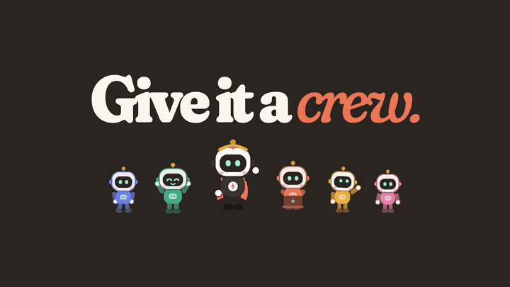
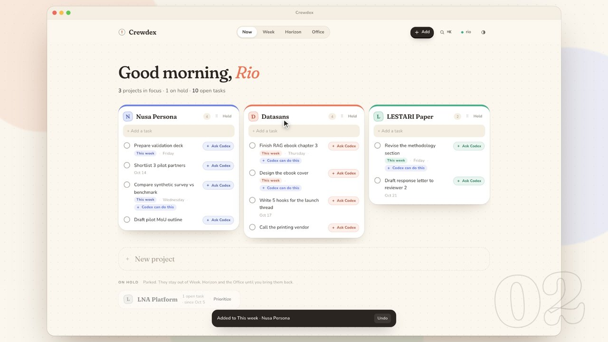
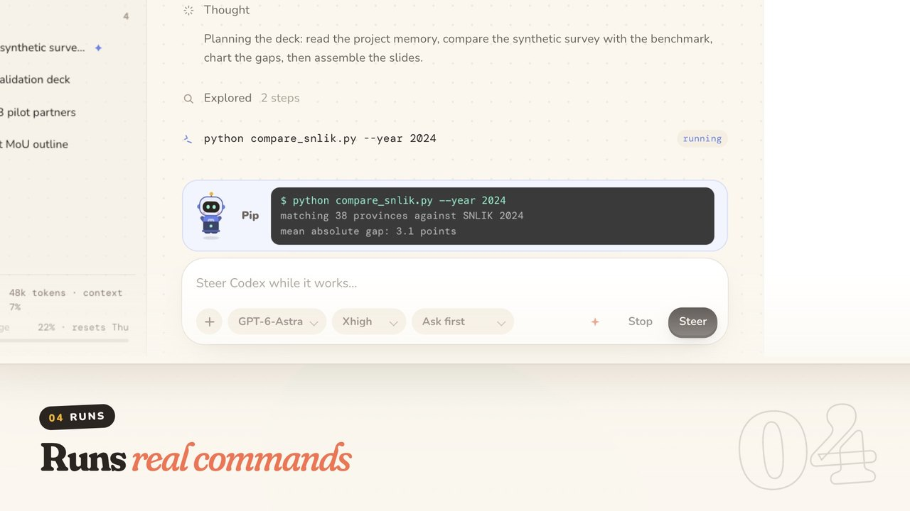
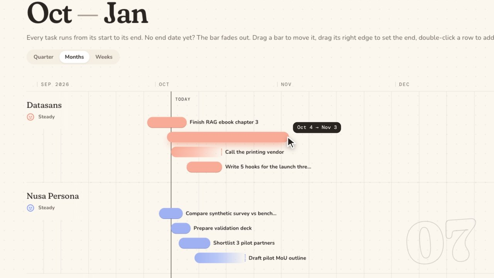
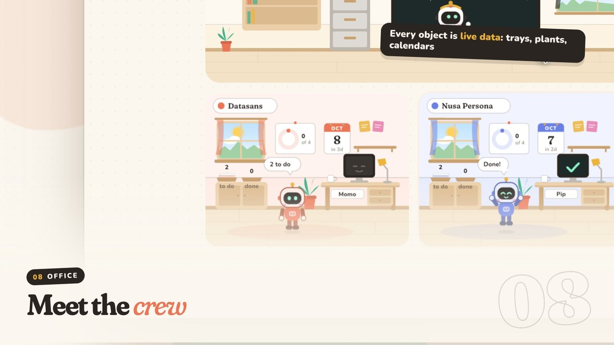

# Crewdex

**Codex, with a crew.**

A native macOS project manager. You plan projects and tasks; any task can be handed to Codex, which works inside that project's own folder and remembers what it learned there.

[](https://arifinrio95.github.io/crewdex/)

**[▶ Watch the full film (3:26, with sound)](https://arifinrio95.github.io/crewdex/)** · [Download it in 1080p](https://github.com/arifinrio95/crewdex/releases/latest/download/Crewdex-film.mp4)

## Install

Paste this into Terminal:

```bash
curl -fsSL https://raw.githubusercontent.com/arifinrio95/crewdex/main/install.sh | bash
```

It downloads the latest release, puts `Crewdex.app` in `/Applications` and opens it.

**Requirements**

- macOS 13.3 or newer, Apple Silicon or Intel
- For the Codex features: the [ChatGPT desktop app](https://chatgpt.com/download) or the Codex CLI (`npm i -g @openai/codex`), signed in. Crewdex finds it automatically and uses your existing login, plugins, MCP servers and skills. Without Codex it still works as a planner.

<details>
<summary>Install by hand, or build it yourself</summary>

**By hand:** download `Crewdex.zip` from [Releases](https://github.com/arifinrio95/crewdex/releases/latest), unzip it and drag `Crewdex.app` to Applications. The app is not notarized by Apple, so the first launch is blocked. Either run

```bash
xattr -dr com.apple.quarantine /Applications/Crewdex.app
```

or open System Settings → Privacy & Security and press **Open Anyway**.

**From source** (needs the Xcode Command Line Tools, no Xcode project):

```bash
git clone https://github.com/arifinrio95/crewdex.git
cd crewdex
./build.sh --install
```

</details>

## What it does

| | |
|---|---|
|  |  |
| **Now.** One column per prioritized project, tasks as rows. Drag to reorder, hold a project to park it. | **Chatroom.** Watch Codex think, read, run commands, search, write files, generate images and use your computer. It asks before risky steps. |
|  |  |
| **Horizon.** Every task as a bar from its start to its end. No end date yet? The bar fades out; drag its edge to set one. | **Office.** One agent per project, and every object in the room is live data. Dex, the orchestrator, plans the week and dispatches agents. |

- **Project management first.** You write the tasks. Codex only touches the task list when you ask it to break a task down or sharpen its wording.
- **Import from Codex history.** Crewdex reads your past Codex sessions, groups them into projects, and brings in their history and memory. Re-run it any time.
- **Ask Codex on any task.** Break down the task, or have Codex write an enhanced prompt, then pick model, reasoning level, access and attachments per chat.
- **Results you can open.** Tables, diagrams, math and code are rendered; click any file to preview it (PDF, decks, charts, CSV, images). Every step is also logged in plain language.
- **Project memory.** Each project has its own folder with `AGENTS.md`, session history, final outputs and skills, so the next session starts where the last one stopped.
- **Skills.** When a result turns out well, save the way it was made as a skill for the project or for all projects.
- **Week and Horizon.** Commit only what you will finish this week, and see every task on a timeline.

## Where your data lives

Everything stays on your Mac, as plain files:

```
~/Crewdex/<project>/
  AGENTS.md                 Codex memory for this project
  artifacts/<task>/         Everything Codex produced for a task
  .agents/skills/           Project-only skills
  .crewdex/project.json     The project and its tasks
  .crewdex/HISTORY.md       One entry per session
  .crewdex/runs/<id>/       steps.md (plain language), events.jsonl (verbatim), run.json
```

Crewdex talks to Codex by launching `codex app-server` on your machine. It sends nothing anywhere else.

## Repository layout

- `Sources/main.swift`: window, WKWebView, file bridge, Quick Look, notifications, the Codex process
- `web/`: the whole interface (plain JavaScript and CSS, no build step)
- `build.sh`: builds a universal `Crewdex.app` with `swiftc`; `--install` copies it to `~/Applications`, `--zip` makes the release archive
- `film/`: the scripted product film. It records the real app against a fake Codex (`demo.js`), directed by `director.js`; music and sound effects are synthesized by `synth.py`

## Notes

- Crewdex is an independent project and is not affiliated with or endorsed by OpenAI. Codex and ChatGPT are trademarks of OpenAI.
- The film uses demo data and a scripted Codex; the model name shown in it is fictional.
- Bundled libraries in `web/vendor`: marked, DOMPurify, highlight.js, KaTeX and Mermaid, each under its own license.

## License

[MIT](LICENSE)
